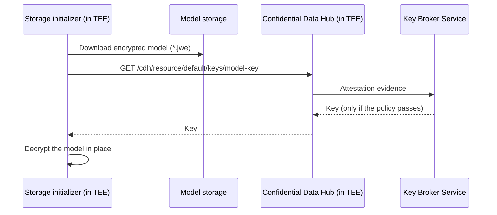

# Confidential Model Serving

Confidential model serving protects model weights while they are stored and while they are served. You upload the model encrypted, and KServe decrypts it only inside a Trusted Execution Environment (TEE), using a key that is released after the TEE proves its identity through hardware attestation. The cluster administrator, the storage provider and the node host never see the plaintext model.

The feature builds on [Confidential Containers (CoCo)](https://confidentialcontainers.org/docs/overview/). If you are new to CoCo, read its [architecture overview](https://confidentialcontainers.org/docs/architecture/) and [trust model](https://confidentialcontainers.org/docs/architecture/trust-model/trust-model/) first, and the [attestation docs](https://confidentialcontainers.org/docs/attestation/) for how Trustee releases keys to attested workloads.

Typical use cases:

- Protecting model IP when serving on infrastructure you do not fully trust, such as a shared or third-party cluster.
- Keeping regulated or proprietary models encrypted at rest in object storage.
- Making sure a model can only be loaded by workloads running on approved, attested hardware.

Confidential model serving works with both `InferenceService` and `LLMInferenceService`.

## How It Works

When `confidential.enabled` is set, KServe injects the `CONFIDENTIAL_ENABLED` and `CONFIDENTIAL_RESOURCE_ID` environment variables into the storage initializer init container. The storage initializer then:

1. Downloads the model artifacts from the `storageUri` (S3, GCS, Azure, Hugging Face, HTTP and so on) as usual.
2. Walks the downloaded files and picks the ones that are JWE encrypted. A file counts as encrypted when it has a `.jwe` extension or when its content starts with a JWE compact serialization header.
3. Asks the Confidential Data Hub (CDH), which runs inside the TEE guest, for the key identified by `resourceId`.
4. CDH performs remote attestation with your Key Broker Service (KBS). The KBS releases the key only if the attestation evidence satisfies its policy.
5. Each encrypted file is decrypted in place inside the TEE. A `.jwe` suffix is dropped from the file name, so `model.joblib.jwe` becomes `model.joblib`. Files that are not encrypted are left untouched.

The model server container then starts and loads the plaintext files from the shared model volume.



KServe does not talk to the KBS directly. CDH handles attestation, so the feature does not depend on a specific RATS protocol or KBS implementation. It works with [Trustee](https://github.com/confidential-containers/trustee), Intel Trust Authority, or any other KBS that CDH supports.

## Where the Decrypted Model Is Stored

KServe decrypts the model into the pod's model volume (`kserve-provision-location`), which is a regular `emptyDir` by default. KServe does not encrypt this volume itself. Its protection comes from CoCo:

- With a confidential runtime class, CoCo creates `emptyDir` volumes as [confidential emptyDir](https://confidentialcontainers.org/docs/features/protected-storage/confidential-emptydir/) volumes: a block device provided by the host and encrypted with LUKS2 inside the guest, so the host only sees ciphertext. This also keeps large models from using up guest memory.
- LUKS2 protects the integrity of each block but not against rollback of the whole volume. The volume is removed when the pod is deleted.
- If your CoCo or Kata configuration does not create confidential emptyDir volumes, `emptyDir` data may be shared from the host and the plaintext model would be visible to it. Check the [protected storage](https://confidentialcontainers.org/docs/features/protected-storage/) docs for your CoCo release before serving sensitive models.
- The nightly release lets cluster administrators replace the default `emptyDir` with another volume through `modelVolumeSource` in the `storageInitializer` config. If you do that, the plaintext model is written to that volume, so make sure it is protected in the same way.

## Prerequisites

- A Kubernetes cluster with [Confidential Containers (CoCo)](https://confidentialcontainers.org/docs/) installed, and nodes or peer pods backed by TEE hardware such as AMD SEV-SNP or Intel TDX.
- A CoCo `RuntimeClass` for the TEE, for example `kata-qemu-snp`, `kata-qemu-tdx` or `kata-remote` for peer pods. Check `kubectl get runtimeclass` for the names in your cluster.
- A Key Broker Service that the CoCo guest is configured to use, with a resource policy that releases the model key to attested workloads.
- KServe v0.21 or later for the steps in this guide. The feature was added in v0.20, but v0.20 expects the KBS resource to hold the raw key bytes rather than a JWK.
- An encrypted model and a decryption key stored in KBS. See [Example: Prepare an Encrypted Model and Key](#example-prepare-an-encrypted-model-and-key) below.

:::note

The storage initializer reaches CDH at `http://127.0.0.1:8006`, the default CDH API address inside a CoCo guest. It can be overridden with the `CDH_ADDR` environment variable.

:::

## Configure the Confidential Spec

The `confidential` field is available on every predictor of an `InferenceService` and on `spec.model` of an `LLMInferenceService`.

| Field | Description |
|---|---|
| `enabled` | Set to `true` to decrypt the model artifacts after download. |
| `resourceId` | KBS resource ID of the decryption key, in the format `kbs:///<repo>/<type>/<tag>`. Each segment may contain letters, digits, `-`, `_` and `.`. |

`resourceId` is optional in the API, but the storage initializer exits with an error when confidential mode is enabled without it, so set it whenever `enabled` is `true`.

### InferenceService

Set the CoCo runtime class on the predictor so that the whole pod, including the storage initializer, runs inside the TEE:

```yaml
apiVersion: serving.kserve.io/v1beta1
kind: InferenceService
metadata:
  name: sklearn-confidential
spec:
  predictor:
    runtimeClassName: kata-qemu-snp
    model:
      modelFormat:
        name: sklearn
      storageUri: s3://my-bucket/encrypted-model
      confidential:
        enabled: true
        resourceId: kbs:///default/keys/model-key
```

### LLMInferenceService

For an `LLMInferenceService`, set the runtime class in `spec.template`:

```yaml
apiVersion: serving.kserve.io/v1alpha2
kind: LLMInferenceService
metadata:
  name: llm-confidential
spec:
  model:
    uri: hf://my-org/my-encrypted-model
    name: my-encrypted-model
    confidential:
      enabled: true
      resourceId: kbs:///default/keys/llm-key
  template:
    runtimeClassName: kata-qemu-tdx
    containers:
      - name: main
        resources:
          limits:
            nvidia.com/gpu: "1"
```

Apply the resource and check that the storage initializer decrypted the model:

```bash
kubectl apply -f confidential-isvc.yaml
kubectl logs <predictor-pod> -c storage-initializer
```

The log should end with a line like:

```
Confidential decryption complete: 1 files decrypted
```

## Validation Rules

The KServe webhook checks the confidential configuration when the resource is created or updated:

- `resourceId` must match `kbs:///<repo>/<type>/<tag>`. Otherwise the request is rejected.
- On an `InferenceService`, the predictor must set `storageUri`. Confidential mode is rejected without it.
- With an `oci://` URI, the webhook returns a warning and the setting has no effect. Encrypted OCI images (modelcars) are decrypted by the container runtime through the CoCo `runtimeClassName`, not by KServe.
- With a `pvc://` URI, the webhook returns a warning and the setting has no effect, because the storage initializer is not injected for PVC volumes.

## Troubleshooting

If decryption fails, the storage initializer exits with a non-zero code and the pod stays in `Init:Error` or `Init:CrashLoopBackOff`. Check its logs:

```bash
kubectl logs <predictor-pod> -c storage-initializer
```

Common causes:

- `CONFIDENTIAL_RESOURCE_ID must be set when confidential mode is enabled`: `resourceId` is missing from the spec.
- `Failed to retrieve key from CDH`: CDH is not reachable, usually because the pod is not running with a CoCo runtime class, or attestation failed or the KBS policy refused to release the key. Check the KBS logs.
- `unsupported JWE alg` or `unsupported JWE enc`: the file was encrypted with an algorithm that is not in the [supported algorithms table](#encrypt-the-model).
- `does not match`: the key in the KBS does not have the length the JWE header expects, for example a 128-bit key used with `A256KW`.

## Example: Prepare an Encrypted Model and Key

This section shows one way to create the encrypted model and the KBS key listed in the prerequisites.

### Encrypt the Model

Model files must be encrypted as JWE compact serialization. The storage initializer supports these algorithms:

| Header | Supported values |
|---|---|
| `alg` (key management) | `A128KW`, `A192KW`, `A256KW`, `dir` |
| `enc` (content encryption) | `A128GCM`, `A192GCM`, `A256GCM` |

JWE compression (`zip`) and `crit` headers are not supported. These limits come from the streaming decryptor in the nightly storage initializer. v0.21 and earlier decrypt each file fully in memory with jwcrypto and are not limited to this list, so give the storage initializer enough memory for your largest file there.

The following script uses [jwcrypto](https://jwcrypto.readthedocs.io/) to encrypt each file it is given with `A256KW` and `A256GCM`, writing `<file>.jwe` next to it. On the first run it creates a 256-bit key and saves it as `model-key.jwk`. Later runs reuse that key, so every file of a model can be decrypted with the same key.

```python title="encrypt_model.py"
import json
import pathlib
import sys

from jwcrypto import jwe, jwk

key_file = pathlib.Path("model-key.jwk")
if key_file.exists():
    key = jwk.JWK.from_json(key_file.read_text())
else:
    key = jwk.JWK.generate(kty="oct", size=256)
    key_file.write_text(key.export())

for name in sys.argv[1:]:
    src = pathlib.Path(name)
    token = jwe.JWE(
        src.read_bytes(),
        protected=json.dumps({"alg": "A256KW", "enc": "A256GCM"}),
    )
    token.add_recipient(key)
    pathlib.Path(f"{src}.jwe").write_text(token.serialize(compact=True))
```

Encrypt the model file and upload the encrypted copy, leaving out the plaintext original:

```bash
pip install jwcrypto
python encrypt_model.py model/model.joblib
aws s3 cp model/ s3://my-bucket/encrypted-model/ --recursive --exclude "model.joblib"
```

This script reads each file into memory, which is fine for most models. For very large weights, any tool that writes standard compact JWE with the algorithms above works too.

Files you do not encrypt, such as configuration files, can be uploaded next to the encrypted ones and are used as they are.

:::warning

Keep `model-key.jwk` out of the model bucket and out of the cluster. It should only be stored in the KBS.

:::

### Store the Key in the KBS

Upload the key to your KBS under a `<repo>/<type>/<tag>` path. Storing the full JWK JSON written by the script above is recommended. A raw key is also accepted, either as raw bytes or as a base64url encoded string.

For example, with the Trustee `kbs-client`:

```bash
kbs-client --url http://<kbs-address>:<port> config \
  --auth-private-key kbs-admin.key \
  set-resource --path default/keys/model-key \
  --resource-file model-key.jwk
```

The resource is then referenced in KServe as `kbs:///default/keys/model-key`. Also make sure the KBS resource policy allows the key to be released to your TEE. See the documentation of your KBS for the policy format.
